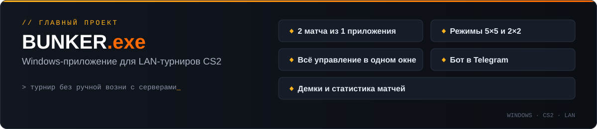
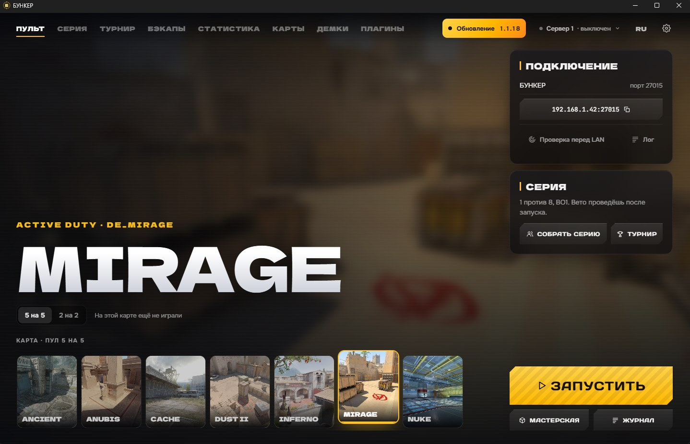
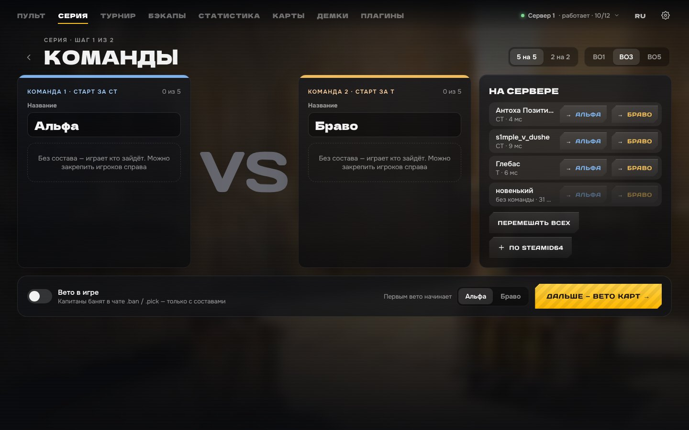
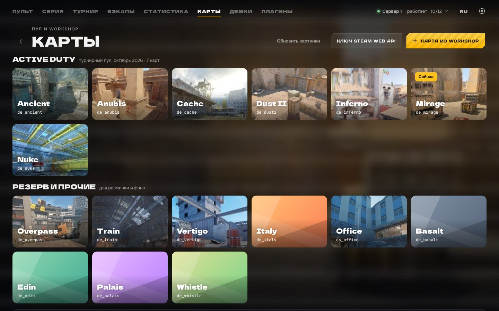
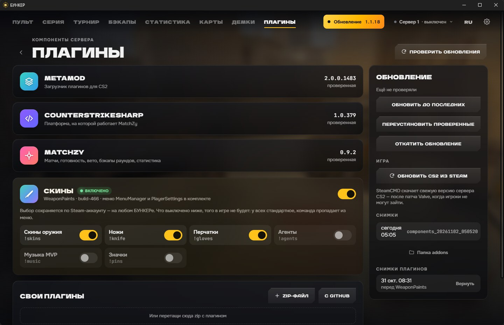
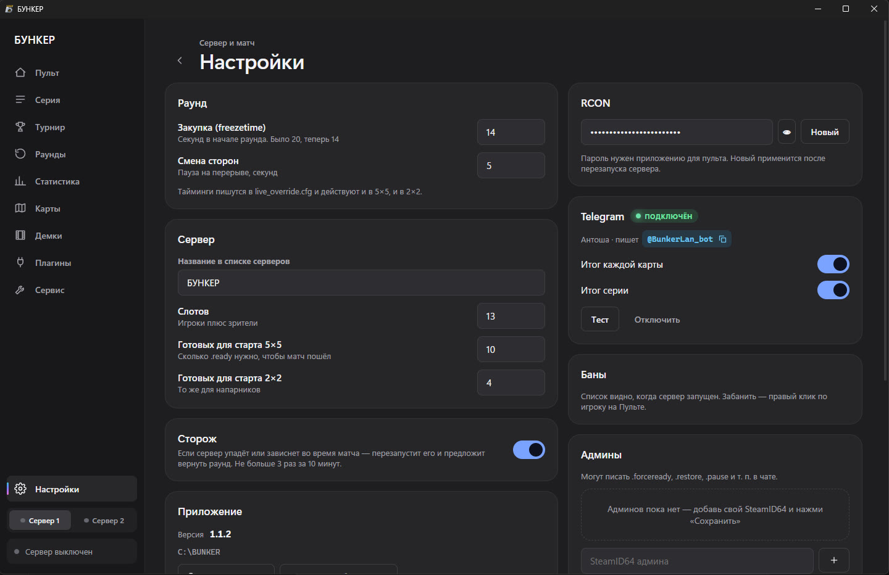

<div align="center">



<a href="https://git.io/typing-svg"></a>

<br/>

<a href="https://t.me/AHTOXA_SamoreZ"></a>
<a href="https://t.me/BunkerLan_bot"></a>
<a href="https://vk.ru/vratarb150cm"></a>
<a href="https://github.com/Sam0rezAHTOXA/BUNKER-releases/releases/tag/v1.1.2"></a>

</div>

---

## 🎯 Обо мне

```yaml
nick:      Антоха
role:      организатор LAN-турниров по Counter-Strike 2
делаю:     инструменты, чтобы провести матч без ручной возни с двумя серверами
проект:    BUNKER.exe 💣
бот:       @BunkerLan_bot 🤖
```

## 💣 Главный проект

<a href="https://github.com/Sam0rezAHTOXA/BUNKER-releases/releases/tag/v1.1.2">
  
</a>

## 📸 Как выглядит

<div align="center">
  
  <sub><b>Пульт</b> — выбор карты и режима 5×5 / 2×2, запуск сервера в один клик</sub>
</div>

<br/>

<table>
  <tr>
    <td width="50%" align="center"><br/><sub><b>Серия</b> — команды, BO1/BO3/BO5, вето</sub></td>
    <td width="50%" align="center"><br/><sub><b>Карты</b> — турнирный пул и Workshop</sub></td>
  </tr>
  <tr>
    <td width="50%" align="center"><br/><sub><b>Плагины</b> — обновления, откаты, скины</sub></td>
    <td width="50%" align="center"><br/><sub><b>Настройки</b> — раунды, сторож, Telegram-бот</sub></td>
  </tr>
</table>

## 🛠️ Стек

<p>
  
  
  
  <a href="https://t.me/BunkerLan_bot"></a>
</p>

## 🙏 На чём работает

BUNKER.exe собран на открытых проектах — спасибо их авторам:

| Инструмент | Автор | Что делает |
|---|---|---|
| [CounterStrikeSharp](https://github.com/roflmuffin/CounterStrikeSharp) | [@roflmuffin](https://github.com/roflmuffin) | фреймворк для серверных плагинов CS2 на C# |
| [MatchZy](https://github.com/shobhit-pathak/MatchZy) | [@shobhit-pathak](https://github.com/shobhit-pathak) | управление матчами, демки и статистика |
| [WeaponPaints](https://github.com/Nereziel/cs2-WeaponPaints) | [@Nereziel](https://github.com/Nereziel) | скины оружия, ножи, перчатки, агенты, музыка MVP, значки — *ставится по переключателю «Скины»* |
| [MenuManagerCS2](https://github.com/NickFox007/MenuManagerCS2) · [PlayerSettingsCS2](https://github.com/NickFox007/PlayerSettingsCS2) · [AnyBaseLibCS2](https://github.com/NickFox007/AnyBaseLibCS2) | [@NickFox007](https://github.com/NickFox007) | меню и настройки игроков для WeaponPaints — *ставятся вместе со «Скинами»* |
| [Metamod:Source](https://www.sourcemm.net/) | [AlliedModders](https://github.com/alliedmodders) | загрузчик плагинов, на котором работает CounterStrikeSharp |

## 📊 Активность

<div align="center">
  
</div>

## 🧪 Тестируешь BUNKER.exe?

Если используешь BUNKER.exe на своём турнире — расскажи, как прошло 🙌
Особенно полезны **точные шаги воспроизведения ошибок**.
Пиши в [Telegram](https://t.me/AHTOXA_SamoreZ) или [VK](https://vk.ru/vratarb150cm). Бот для турниров — [@BunkerLan_bot](https://t.me/BunkerLan_bot).

<div align="center">
<br/>

<br/>
<sub>gl hf 🎮</sub>
</div>
